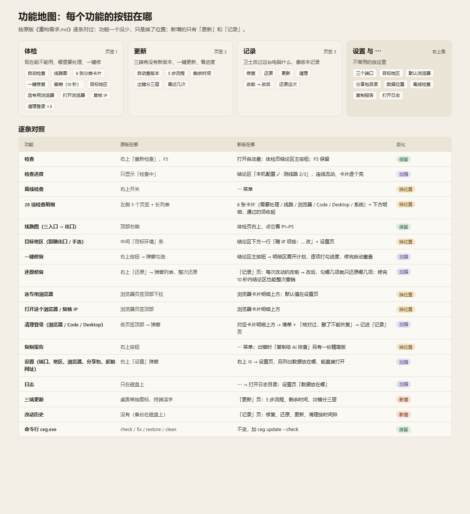

# Claude 环境卫士

> 换了代理节点之后，双击它，5 秒告诉你：Claude 的三个入口是不是还走同一个干净的出口、有没有哪里漏了真实位置；不对的地方一键修好，修错了能按项撤回。

[](https://github.com/xgz123-wq/ClaudeEnvGuard/releases/latest)


[](LICENSE)



## 它解决什么问题

在国内用 Claude，通常要让流量经代理从海外出去。麻烦在于 Claude 有三个入口——**浏览器网页版、Claude Code（命令行）、Claude Desktop（桌面版）**——每个入口的代理设置各管各的，而且除了 IP，还有很多地方会暴露你的真实位置：

| 容易出问题的地方 | 表现 |
|---|---|
| 三个入口出口不一致 | 浏览器从美国出去，Claude Code 却从日本出去，同一个账号短时间内「跳国家」 |
| DNS、WebRTC、IPv6 泄漏 | IP 是海外的，但域名解析、浏览器 WebRTC 或 IPv6 绕过代理，露出国内网络 |
| 时区、语言对不上 | 出口在美国，系统时区却是北京时间、浏览器语言是中文 |
| 代理配置被改掉或丢了 | 更新、重装后某个入口的代理设置没了，悄悄直连 |

这些项一个个手动查很费事，换一次节点就要重查一次。环境卫士把它们做成一张体检单：**打开就查、约 5 秒出结果，按出口 IP 所在地推算该有的时区和语言，不对的项给出修复计划，你确认后执行，每一步都先备份。**

## 适合谁

| 情况 | 能不能用 |
|---|---|
| 已经按 [Claude 环境分享包](https://github.com/xgz123-wq/claude-env-share) 部署好环境 | ✅ 全部功能可用，这是它的设计前提 |
| 自己用 Clash Verge 配过类似环境，三个入口各有专用端口 | ⚠️ 体检、修复能用；在「⚙ 设置」里改成你的端口。更新、深度总检、英文启动用不了（见下面「哪些功能要分享包」） |
| 什么都还没配，想找一个「装上就能用 Claude」的工具 | ❌ 它不搭环境、不提供代理，只负责体检和修复。先看[分享包](https://github.com/xgz123-wq/claude-env-share) |
| macOS / Linux | ❌ 只支持 Windows |

## 快速开始

1. 到 [Releases](https://github.com/xgz123-wq/ClaudeEnvGuard/releases/latest) 下载 `ClaudeEnvGuard.exe`（图形界面）和 `ceg.exe`（命令行），放进同一个文件夹，例如 `D:\Tools\ClaudeEnvGuard\`。
2. 双击 `ClaudeEnvGuard.exe`。程序没有代码签名，Windows 可能提示「已保护你的电脑」，点「更多信息 → 仍要运行」。
3. 打开即自动体检。全绿就不用管；有红黄项，点结论区的「一键修复」，看清计划再勾选执行。

- **不用安装**：两个 exe 是独立程序，不需要 Python、Node 或其他运行库；图形界面用 Windows 11 自带的 WebView2（Windows 10 没有的话按提示装一次）。
- **不需要管理员**：只有改系统时区、IPv6、Desktop 代理策略这几项会弹一次 UAC，由你点确认。

## 能做什么

| 页面 | 做什么 |
|---|---|
| 体检 | 线路、专用浏览器、Claude Code、Desktop、系统五类共二十多项检查；一键修复、深度总检、打开专用浏览器人工复核、清理登录数据 |
| 更新 | 查 Desktop、CLI、VS Code 插件三端的新版本（约 2 秒），一键更新并显示进度 |
| 记录 | 每次修复、还原、更新、清理按时间排列，显示「改之前 → 改之后」；修复可以只勾几项撤回 |
| ⚙ 设置 | 三个端口、目标地区、专用浏览器和起始网址、分享包目录、数据存放位置 |

每一项检查查什么、哪些能自动修，见 [新版/README.md「检查项」](新版/README.md#检查项)；可点的界面原型见 [原型/](原型/)，下载后双击 HTML 就能打开。

## 哪些功能要分享包

exe 自己就能完成体检、修复、还原、清理。下面三个功能是给分享包里的 PowerShell 脚本套界面，**没有分享包时会提示找不到脚本**：

| 功能 | 调用的脚本（分享包内的位置） |
|---|---|
| 整个更新页（查版本 + 一键更新） | `docs\配置\Claude环境\Desktop防护\更新三端Claude.ps1` |
| 深度总检 | `docs\配置\Claude环境\Claude环境一键总检.ps1` |
| 检查后启动 Desktop（英文） | `docs\配置\Claude环境\启动Claude英文浏览器.ps1` |

- **脚本找法**：依次找 `桌面\AI应用开发`、「⚙ 设置」里填的分享包目录、`桌面\Claude环境分享版`，用第一个找到的。分享包放在别处时，在设置里填它的根目录。
- **还需要**：PowerShell 7（`pwsh`），分享包本来就要求装。
- **查版本**：由程序自己联网查（约 2 秒），但开始前会先确认更新脚本在，找不到就报「查版本失败」，所以同样要分享包。

## 安全吗

- **改之前先备份**：每个修复动作执行前把旧值或旧文件存进 `%LOCALAPPDATA%\ClaudeEnvGuard\备份\`，失败自动撤回；修完 10 秒内可一键撤销，之后在「记录」页按项还原。
- **只改白名单**：需要管理员的动作只允许改 Claude 代理策略、时区、IPv6、指定环境变量和指定防火墙规则。
- **清理先列清单**：清登录数据前列出每个要删的路径，勾「我核对过」才删；Claude 在运行时拒绝清理；删了什么写进记录，不含凭据内容。
- **查不到就说查不到**：读不到、超时一律显示「未知」，不会显示「通过」。
- **会联网访问的地址**：`claude.ai`（看 Claude 眼里的 IP，只经专用端口）、`ip.net.coffee` 和 `ipinfo.io`（查出口所在地和时区）；更新页另查 npm、VS Code 市场和 Claude Desktop 官方下载入口。除了这些查询，不向任何地方发送本机数据。

## 命令行

`ceg.exe` 和图形界面是同一套检查，适合脚本或让 AI 助手调用：

```bash
ceg check            # 全量体检
ceg fix --plan       # 只列修复计划，不改任何东西
ceg update --check   # 只查三端版本
```

全部命令和退出码见 [新版/README.md「命令行」](新版/README.md#命令行cegexe)。

## 常见问题

| 问题 | 回答 |
|---|---|
| 全是「失败」或「未知」 | 多半是代理客户端没开，或端口和默认的 43865 / 43866 / 43867 不一样；到「⚙ 设置」改端口后会自动重查 |
| 只支持 Clash Verge 吗 | 端口、出口、DNS 等通用项任何代理客户端都能查；「Clash 配置」那一项（P2）只认 Clash Verge Rev |
| 体检全绿就一定安全吗 | 它查的是启动参数和系统设置。WebRTC、浏览器里的 JS 时区等最终以专用浏览器打开 `ip.net.coffee/claude/` 人工看一眼为准，体检页有「打开这个浏览器」按钮 |
| 杀毒软件报毒 | 没签名的 Go 程序偶尔被误报；不放心可以按 [维护者指南](维护者指南.md) 从源码自己打包 |
| 怎么卸载 | 删掉两个 exe 和桌面图标；数据在 `%LOCALAPPDATA%\ClaudeEnvGuard\`，不要了就一起删 |

## 文档

| 想看 | 文件 |
|---|---|
| 每项检查、命令行、数据存哪、更新页细节 | [新版/README.md](新版/README.md) |
| 改代码、打包、发版本、回退旧版 | [维护者指南.md](维护者指南.md) |
| 最近改了什么、哪些还没验证 | [维护记录.md](维护记录.md) |
| 设计需求原文 | [重构需求.md](重构需求.md)、[更新并入需求.md](更新并入需求.md) |

## 许可证

[MIT](LICENSE)：可以自由使用、修改、再分发，保留版权声明即可；不提供任何担保。
