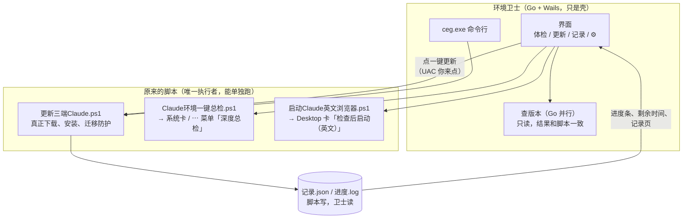

# 复盘：三端更新并入环境卫士（v2.1.0 → v2.5.0）

> 用法：先看两张图，再看 8 个设计点，最后**自己答题**。答案折叠在每题下面，先写下你的答案再展开。
> 过程逐段记录见 [02-过程记录.md](02-过程记录.md)。

---

## 一、总览图：这一次是怎么做完的

**一句话**：先量出慢在哪 → 用原型对齐「要什么」→ 写成一份文档 → 先想好怎么退 → 才动手。

---

## 二、结构图：卫士和脚本是什么关系

要点：**脚本做事，卫士只负责「让你看见」**。删掉卫士，桌面上的脚本照样能用。

---

## 三、8 个值得学的设计点

| # | 设计点 | 这次怎么用的 | 能带走的原则 |
|---|---|---|---|
| 1 | **先量再改** | 以为是 PowerShell 慢，实测是 3 个版本源排队查 | 优化前先找瓶颈，别先换技术栈 |
| 2 | **等待分档** | <1 秒不提示；1–10 秒转圈；>10 秒给百分比 + 剩余时间 | 等待的痛苦来自「不知道还要多久」 |
| 3 | **一屏一个主按钮** | 更新页只有「一键更新」是实心按钮，5 步横向排一屏 | 让人不用想下一步点哪 |
| 4 | **摩擦和风险成正比** | 修复可 10 秒撤销；清理登录要勾「删了不能恢复」；UAC 本身就是确认，不再加弹窗 | 能撤销的不拦，不能撤销的才拦 |
| 5 | **出错分三层** | UI 自己重试 → 要你动手（如「先退出 VS Code」）→ 复制给 AI 排查 | 报错前先问：这是谁该处理的？ |
| 6 | **单一执行者** | 脚本是唯一干活的，卫士只调用和读记录；新功能靠「脚本里有没有这一段」判断，旧脚本仍能用 | 两处各写一份逻辑，迟早不一致 |
| 7 | **先想好怎么退** | 独立 worktree、独立模块、部署前留旧 exe、脚本改前备份且向后兼容 | 回退方案要在动手前写进文档 |
| 8 | **脚本 + 模型分工** | 域名复核：脚本比对官方清单；只有出现未归类新域名才让模型判断 | 确定的事交给脚本，要判断的才交给模型 |

还有一个**测试小技巧**：同版本 `--force` 重装，VS Code 直接跳过，等于没测。要先降一版、再升回来，才是真装了一次。

---

## 四、考题（必须自己答）

> 规则：每题先在「我的答案」后面写下选项和一句理由，再展开看参考答案。答错的写进第五节。

### 第 1 题 · 找瓶颈
三端更新查版本要 6 秒多，下面哪个改法**最该先做**？

- A. 用 Rust 重写，因为编译型语言更快
- B. 先计时，看时间花在哪一步
- C. 加缓存，第二次打开就快
- D. 加一个更好看的加载动画

我的答案：

参考答案

**B**。这次实测发现慢在 3 个版本源排队查，并行后 1.9 秒，跟语言无关。A 是猜测；C 治标，第一次照样慢；D 是改善「感觉」，但应该在知道真实耗时之后再定用哪档反馈。

### 第 2 题 · 等待反馈
一键更新大约要 40 秒。按「等待分档」，界面该给什么？

- A. 一个转圈图标
- B. 什么都不给，完成后弹窗
- C. 当前第几步 + 百分比 + 剩余时间
- D. 一行滚动日志

我的答案：

参考答案

**C**。超过 10 秒，转圈不够，人会怀疑「卡死了吗」。剩余时间用历史记录里每一步的平均耗时来估，所以记录页不只是给人看的，也喂给估时。

### 第 3 题 · 摩擦放在哪
下面三件事，哪一件**应该**加「我核对过，删了不能恢复」这种额外确认？

- A. 一键修复（修完 10 秒内能撤销）
- B. 一键更新（会弹 UAC）
- C. 清理浏览器登录数据

我的答案：

参考答案

**C**。A 可撤销，拦它只会烦人；B 的 UAC 已经是一次确认，再弹一次是重复；C 删了就没了，才值得多一步。

### 第 4 题 · 出错是谁的事
更新时发现 VS Code 开着，插件装不了。哪种处理最好？为什么不选另外两个？

- A. 报错「更新失败」，给错误码
- B. 显示待办「先退出 VS Code」，退出后能接着走
- C. 自动结束 VS Code 进程，继续更新

我的答案：

参考答案

**B**。这不是故障，是「要你动手」的一层。A 把正常情况说成失败，你还得自己猜原因；C 可能丢掉你没保存的东西，脚本原来就定了「不强杀」。

### 第 5 题 · 单一执行者（开放题）
卫士 v2.3.0 把「查版本」用 Go 重写了一遍，但「真正更新」还留在脚本里。
**用你自己的话说**：为什么查版本可以重写，更新却不重写？重写查版本时，靠什么保证两边不出偏差？

我的答案：

参考答案方向

查版本是只读的，写错了最多显示错，不会改坏电脑，而且它在打开卫士时就跑，最影响等待；更新会装软件、迁移防护、要 UAC，脚本已经验过很多次，重写风险大、收益小。保证不偏差：Go 版照着脚本逻辑写，再在同一台机器上两边各跑一次，28 个字段逐个对比一致（28/28）才上线。

### 第 6 题 · 向后兼容
阶段 4 改了脚本，让它能自己装插件。卫士怎么知道该走「自动装」还是旧的「请在 VS Code 里点更新」？

- A. 看卫士自己的版本号
- B. 看脚本里有没有 `--install-extension` 这一段
- C. 问用户
- D. 两种都试一遍

我的答案：

参考答案

**B**。看「对方有没有这个能力」，而不是看版本号。这样你把脚本退回旧版，卫士自动按旧流程走，两边可以各自回退。

### 第 7 题 · 回退（开放题）
如果明天你想彻底退回「卫士 v2.0.2 + 独立脚本」，要做哪几步？按顺序写下来，不看维护记录。

我的答案：

参考答案方向

1. 关掉卫士，从 GitHub Release `v2.0.2` 下载 `ClaudeEnvGuard.exe`、`ceg.exe`，覆盖根目录的同名文件（根目录只留部署时的上一版，更早的都在 Release）。
2. 脚本从 `%LOCALAPPDATA%\ClaudeNetworkGuard\卫士并入前备份-20261024-160202\` 覆盖回去（只想退掉插件自动装，用 `插件自动更新前备份-20261024-175419\`）。不退也能用，因为脚本改动向后兼容。
3. 代码层面：`git checkout v2.0.2`，或从该标签开分支。
4. 跑一次 `ceg check`，确认结果和以前一样。

关键是：这四步在动手前就已写进需求文档 2.1 节，不是事后想的。

### 第 8 题 · 测试是否真的测到了
你想验证「命令行装插件不会改掉版本锁定」。当前已是最新版 2.1.310，下面哪个测法有效？

- A. `code --install-extension ...@2.1.310 --force`
- B. 先装 2.1.309，看锁定；再装回 2.1.310，看锁定
- C. 看 VS Code 插件页面有没有报错
- D. 重启 VS Code

我的答案：

参考答案

**B**。A 是同版本，VS Code 直接跳过，什么都没发生，却会让你以为「测过了没问题」。测试前先问一句：这个动作真的会让被测的东西发生变化吗？

### 第 9 题 · 脚本还是模型（开放题）
Claude 官方域名清单会变。下面每一步，你觉得该交给**脚本**、**模型**还是**你自己**？

| 步骤 | 你的答案 |
|---|---|
| 抓官方文档、提取域名、和本地规则比对 |  |
| 新冒出来的域名是 Claude 专属还是共享的 CDN |  |
| 把新规则写进 Clash 并重载 |  |
| 在真实浏览器里确认网页能打开 |  |

参考答案

脚本 / 模型 / 你 / 你。比对是确定的规则，脚本做又快又不会漏；判断用途要读说明，模型做；改 Clash 和真实验收会影响正在用的网络，留给你。见 `DNS分层说明.md`「Claude 域名定期复核」。

---

## 五、我的错题与新想法

| 题号 | 我当时怎么想的 | 现在明白了什么 |
|---|---|---|
|  |  |  |

---

## 六、还没真机验证的（留给下次）

- 三端真有新版本时，在「更新」页点「一键更新」走完整一遍（含 UAC、迁移防护、回读）
- 记录页按项还原
- 「检查后启动 Desktop（英文）」真的拉起 Desktop
